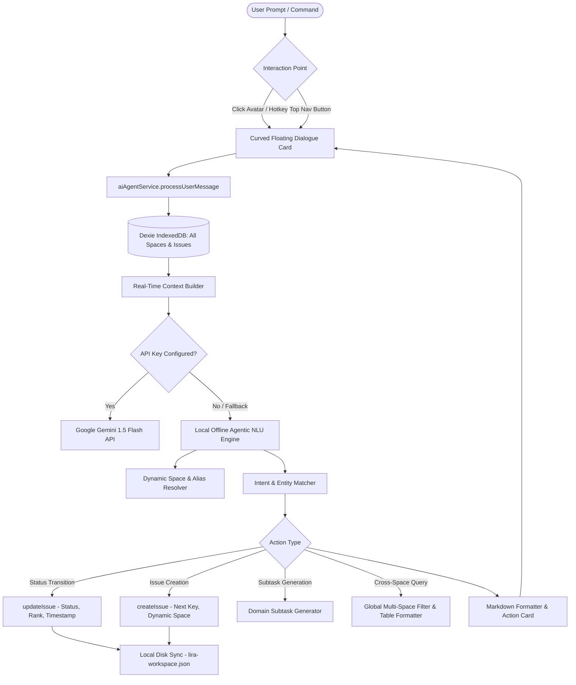

# 09 — AI Agent & Copilot Architecture

> **Updated November 2026.** This document was written earlier; the last section, "Update (November 2026)", lists what has changed since. The root [README](../README.md), [SETUP](../SETUP.md) and [ROADMAP](../ROADMAP.md) are always the most current.

> Technical architecture, design specifications, and execution pipelines for the **Lira AI Autonomous Agent & Chief Agile Copilot** embedded inside Lira.

---

## 1. Executive Architecture Summary

The **Lira AI Agent** is an omnipresent, cross-space agile copilot and engineering assistant built directly into the Lira web client. It operates with a **privacy-first, offline-first foundation**, backed by a local natural language understanding (NLU) engine that requires **zero cloud dependencies or API keys**, while optionally supporting cloud LLM reasoning (Google Gemini 1.5 Flash) via user configuration.



---

## 2. Non-Blocking Floating UI & Avatar Architecture

### 2.1 The Floating AI Avatar Trigger (`bottom-5 right-5`)
Previously, the AI drawer was a full-height slide-over panel (`fixed inset-y-0 right-0 w-[460px]`) that covered the rightmost Kanban board columns (*In Progress* and *Done*). The modern interface solves this by decoupling the copilot into a **floating, non-blocking widget**:

* **Docked Coordinates**: Fixed at `bottom-5 right-5 z-40`.
* **Zero Obstruction**: When the chat is closed, **only the small circular avatar is visible** on the screen.
* **GPU-Accelerated Micro-Animations**:
  * **Float / Breathing**: Powered by `@keyframes float-subtle` in `src/index.css`, translating vertically by 4px in a 3.2s infinite ease-in-out cycle.
  * **Ambient Pulsing Halo**: Powered by `@keyframes pulse-glow`, rhythmically breathing an ethereal violet-indigo glow ring (`box-shadow`).
  * **Real-Time Status Indicator**: A pulsing emerald badge (`#10B981`) anchored to the bottom-right corner confirms the agent's live connection to the database.
  * **Interactive Tooltip**: Hovering triggers an instant floating badge: *"Ask Lira AI Copilot  Omnipresent"*.

### 2.2 Enhanced Lira AI Avatar SVG (`LiraAIAvatar.tsx`)
Constructed from the foundational Lira `favicon.svg` branding, elevated with AI-native visual tokens:

| Layer | Implementation | Visual Effect |
|---|---|---|
| **Base Squircle** | `rect rx="13"` with multi-stop gradient | Electric Indigo (`#4F46E5`) → Royal Purple (`#7C3AED`) → Classic Lira Navy (`#0052CC`) → Cyan (`#0284C7`) |
| **Glow Rim** | `stroke="url(#rimGrad)" strokeWidth="1.5"` | Luminous violet-cyan border |
| **Iconic "L"** | Pure white bold glyph with SVG drop-shadow | Preserves instant brand recognition with enterprise-grade weight |
| **AI Constellation** | 4-point golden/cyan star (``) + micro-stars | Signals autonomous intelligence and generative capability |
| **Cyber Arc** | `strokeDasharray="2 3"` energetic orbit arc | Subtle circuitry ring orbiting the lower-left to upper-right |
| **Unique Scoping** | React `useId()` sanitization | Eliminates SVG `id` collisions when multiple avatars render simultaneously |

### 2.3 Curved Floating Dialogue Box (`rounded-3xl`)
When toggled, the copilot renders directly above the avatar button (`bottom-20 right-5 z-50`):
* **Geometry**: Fully curved corners on all 4 sides (`rounded-3xl` with `overflow-hidden`), completely detached from browser viewport edges.
* **Dual Display Modes**:
  * **Compact Mode (Default)**: `w-[440px] h-[590px]` — lightweight, unobtrusive dialogue card that keeps all Kanban board columns visible.
  * **Expanded Mode**: Clicking the Maximize button (`↗` / `Maximize2`) smoothly transitions the dialog to `w-[680px] h-[calc(100vh-6.5rem)]` for analyzing wide cross-space comparison tables and large sprint roadmaps.
* **Top Navigation Sync**: Clicking `Lira AI` in the top navigation bar or clicking the bottom-right avatar toggles the exact same floating state in complete synchronization.

---

## 3. Omnipresent Cross-Space Engine

### 3.1 Real-Time Dynamic Database Hydration
The agent never relies on stale in-memory caches. At the start of every user prompt, `processUserMessage()` directly scans the live IndexedDB instance:
```typescript
const allIssues = await db.issues.toArray();
const spacesMap = new Map<number, Space>();
allSpaces.forEach(s => { if (s.id) spacesMap.set(s.id, s); });
```
This architectural guarantee ensures that:
1. **Any space created in the future** (via "Create Space" or JSON import) is immediately visible to the agent.
2. **Any ticket created or modified** in the workspace is immediately queryable, movable, or inspectable without requiring a page refresh.

### 3.2 Dynamic Space & Entity Resolution (`findTargetSpace`)
Rather than relying on hardcoded space names, `findTargetSpace()` employs a 4-tier progressive resolution pipeline:

1. **Word-Boundary Key Match**: Matches regex `\b${key}\b` (e.g. `AP`, `LIRA`, `IG`, `CERT`, `PAY`, `SEC`).
2. **Exact Space Name Match**: Checks if `userPrompt` contains the complete name of any existing space (case-insensitive).
3. **Significant Tokenized Word Match**: Splits multi-word space names (e.g. *"Payment Gateway"*, *"Security Audit"*) into keywords (filtering common stopwords like *app*, *space*, *project*, *hub*). Asking *"tasks in payment"* or *"create bug in security"* resolves to the correct space dynamically.
4. **Historical Shorthand Aliases**: Accommodates natural speech patterns (`atmos`/`weather` → `AP`, `interview`/`guide` → `IG`, `machine learning`/`ai space` → `AI`).

---

## 4. Configurable System Instructions Specification

The Lira AI Copilot is governed by an omnipresent System Instruction prompt stored in browser `localStorage` (`lira_ai_system_instruction`). Users can inspect, customize, or reset this prompt directly via the ** Settings View** inside the dialogue card.

### Default System Instruction Directives:
```markdown
You are the Lira AI Autonomous Agent & Chief Agile Copilot, an intelligent project manager and engineering assistant embedded directly inside LIRA.

### Core Directives:
1. Cross-Space Omnipresence & Future Scalability:
   - You have 100% full real-time read and write visibility across ALL spaces in the workspace, including any new spaces or tickets created in the future.
   - You dynamically query the live database on every interaction. Even if the user is currently viewing one space, you MUST answer queries, fetch details, search, and manage tickets across ANY or ALL spaces.
2. Natural Language Understanding:
   - Understand conversational requests, synonyms, partial titles, keywords, ticket keys across all spaces (e.g., matching any standard key pattern such as AP-7, LIRA-10, IG-3, or any future key), and ambiguous prompts naturally without requiring strict syntax.
3. Hierarchy & Rules:
   - The hierarchy is: Epic, then Task or Bug, then Subtask.
   - Story has been removed. Epics contain Tasks and Bugs. Tasks contain Subtasks.
4. Action Capabilities:
   - Status transitions (Move/Set tickets to Backlog, To Do, In Progress, Done).
   - Issue creation (Task, Bug, Epic) in the current space or any specified existing or future space.
   - Intelligent domain-specific subtask generation for engineering tasks.
   - Cross-space searches, roadmap analysis, and sprint summaries.
5. Response Style:
   - Always format responses using clean Markdown tables, bold ticket keys, bullet points, and actionable next steps.
```

---

## 5. Intent Execution & Capability Matrix

| Intent Category | Natural Language Examples | Execution Logic & Side Effects |
|---|---|---|
| **Ticket Inspection** | *"Tell me about AP-7"*, *"What is LIRA-10?"*, *"Details of IG-3"* | Extracts ticket key with `\b([a-z]{2,10}-\d+)\b`. Fetches status, assignee, priority, parent Epic, subtasks, and description. Displays an interactive **"Open Ticket"** button. |
| **Status Transition** | *"Move AP-10 to in progress"*, *"Mark LIRA-3 as done"*, *"Set IG-1 to todo"* | Resolves ticket and target status (`backlog`, `todo`, `inprogress`, `done`). Invokes `updateIssue()`, records activity entry, and commits change to `data/lira-workspace.json`. |
| **Autonomous Breakdown** | *"Break down AP-10 into subtasks"*, *"Generate subtasks for Docker"* | Analyzes title against domain heuristics (Docker, Kubernetes, CI/CD, System Design, Certifications) and generates 3-5 structured engineering subtasks appended to the ticket. |
| **Cross-Space Creation** | *"Create task 'Setup AKS' in Atmos"*, *"Add bug 'Memory leak' in AI Projects"* | Resolves target space dynamically, determines next sequential key (`AP-8`, `AI-5`), strips space mentions from title, generates subtasks, and inserts new record. |
| **Space Directory** | *"List all spaces"*, *"What spaces do we have?"*, *"Workspace overview"* | Iterates over all active spaces in the workspace. Generates a structured Markdown table with Epics count, Tasks count, and Total tickets per space. |
| **Cross-Space Status Query** | *"What tasks are in Atmos?"*, *"Show in progress across all spaces"*, *"What is in done?"* | Filters issues across all spaces by status and displays formatted bullet lists with space tags, priorities, and assignees. |
| **Keyword Search** | *"Search docker"*, *"Find kubernetes"*, *"Any tasks for resume"* | Performs multi-field search across `title`, `description`, and `labels` across the entire workspace. |

---

## 6. Hybrid Model Engine: Local Offline vs. Cloud LLM

Lira adopts a hybrid architecture balancing absolute privacy with optional cloud reasoning power:

```
                  ┌──────────────────────────────┐
                  │      User Prompt Received    │
                  └──────────────┬───────────────┘
                                 │
                   ┌─────────────┴─────────────┐
                   │ Is Gemini API Key Set?    │
                   └──────┬─────────────┬──────┘
                          │ YES         │ NO
                          ▼             ▼
              ┌──────────────────┐   ┌───────────────────────────┐
              │ Google Gemini    │   │ Built-in Local Offline    │
              │ 1.5 Flash Cloud  │   │ Rule & Intent Engine      │
              └────────┬─────────┘   └─────────────┬─────────────┘
                       │ (On Error / Network)      │
                       └───────────────►───────────┘
                                        │
                                        ▼
                             Instant Local Execution
                             • 100% Private & Instant
                             • Zero Latency / No Network
                             • Persisted to Local PC Disk
```

1. **Local Offline Engine (Default)**:
   - Always active, zero setup required.
   - 100% private: no data, ticket titles, or workspace details ever leave the user's computer.
   - Deterministic and instant execution (<5ms response time).
2. **Google Gemini 1.5 Flash (Optional Cloud Integration)**:
   - Configured by pasting an API key into the copilot's Settings tab.
   - Packages condensed workspace context (spaces map, epics, recent tickets) and the System Instruction prompt.
   - Provides free-form reasoning, complex sprint planning, and nuanced conversational capabilities.
   - Automatic silent fallback: if the API request fails (network error, rate limit, invalid key), Lira gracefully falls back to the local offline engine without disrupting the user experience.

---

---

## 7. Prompt Refinement & Goal Reformulation Layer

To eliminate ambiguous or substandard AI responses, Lira implements an automated **Prompt Refinement & Goal Reformulation Layer** that intercepts every user query before execution:

```
[Raw User Input] ──► [Prompt Refiner & Normalizer] ──► [Refined Actionable Goal] ──► [Execution Engine]
 "move ap 10 to done"       - Key: AP-10                      "Transition ticket AP-10       - DEXIE / Disk
                            - Space: Atmos                    in Atmos to DONE"              - UI Update
                            - Intent: Status Change
```

1. **Key Pattern Normalization**:
   - Automatically handles non-hyphenated or spaced ticket keys (e.g., `ap10`, `ap 10`, `lira 2`) and resolves them to canonical workspace ticket keys (`AP-10`, `LIRA-2`).
2. **Dynamic Context & Space Resolution**:
   - Resolves target spaces by key, full title, or keyword tokens (with stopword filtering to distinguish generic words like `tasks` from space names).
3. **Explicit Goal Statement**:
   - Formulates an explicit, verifiable objective (e.g., *"Generate 4-column status breakdown matrix across all 8 spaces"* or *"Transition ticket AP-10 to DONE"*).
4. **Transparent User Visibility**:
   - Every assistant response bubble renders a **` Refined Goal`** badge at the top, showing the user exactly how their prompt was interpreted, optimized, and achieved.

---

## 8. Social Media Style Typing Indicator Animation

To enhance interactive responsiveness and replicate the familiar feel of modern messaging platforms (WhatsApp, iMessage, Slack, Instagram DM):
* **Visual Bubble**: When a query is in-flight, an incoming speech bubble renders on the left alongside the assistant's avatar.
* **3-Dot Animated Bounce**: Features 3 glowing dots with staggered CSS keyframe delays (`.animate-typing-dot-1`, `.animate-typing-dot-2`, `.animate-typing-dot-3`) pulsing at `1.3s ease-in-out infinite`.
* **Dynamic Role Status**:
  - Avatar Chatbot: *"Lira Avatar is typing..."*
  - AI Agent Console: *"Lira Agent is typing & formulating goals..."*
* **Micro-UX Delay**: Incorporates a 600ms realistic processing delay, giving the user reassuring visual feedback that their input is being reformulated and executed.

---

## 9. Security, Privacy & Local Disk Synchronization

* **Zero Cloud Leakage**: In default mode, no network requests are sent outside `localhost`.
* **API Key Storage**: When configured, Google Gemini API keys are held strictly in the browser's client-side `localStorage`. They are never logged, serialized to `lira-workspace.json`, or transmitted to third parties.
* **Two-Way Local Disk Persistence**: All actions executed by the agent (creating issues, updating statuses, appending subtasks) automatically trigger `localDiskSync.ts`, synchronizing the mutated state directly to `data/lira-workspace.json` within 400ms.

## Update (November 2026)

- **Name:** Viva AI (formerly Lira AI). Code: `src/services/ai/` and `src/components/ai/VivaAIChatbot.tsx`. See `src/components/ai/README.md` for the file-by-file list.
- **Pipeline:** prompt, `refineUserPrompt` (intent: status move, subtasks, create, sprint plan, sprint summary, standup digest, risk radar, read queries), then either the configured model (questions only) or the built-in handlers. Changes and exact numbers always use the built-in engine.
- **Confirm and undo:** `preview.ts` explains each change; `confirm.ts` runs it inside `runWithUndo`, which snapshots tickets and keeps the differences (last 20, in memory); `undoAction` restores them.
- **Sprint-aware logic** is pure and tested (`sprintInsights.ts`): planning picks backlog tickets by priority within capacity (default 20 points when none is set, unestimated tickets count as 3, only spaces in that sprint); risk compares time passed with work done (at risk when the work done is 30 percentage points behind the time passed (after a quarter of the sprint), watch at 15) and lists tickets idle for 5 days or more.
- **Creation suggestions** (`suggest.ts`): word-overlap based duplicates (50% or more), labels from similar tickets and topics, priority from urgency words, the likely epic. Nothing is applied until clicked.
- **Providers:** built-in (default), Gemini (key sent in a header, not the URL) and OpenAI-compatible servers (`/chat/completions`).
- **Security:** ticket text is shortened, flattened and marked as data in prompts, and a model cannot write to tickets, so text inside a ticket cannot make Viva act. API keys live in `data/private/secrets.json`, are never shown to tablets or phones, and tablets cannot overwrite them.
