# Database schema

<!-- Generated from api/migrations by `npm run schema-doc` in api/. Do not edit by hand: a test fails when this file is out of date. -->

27 tables. Each is scoped to an organisation (`org_id`) unless it belongs to a person, a session or a team; the API filters every query by it.

## Relationships

```mermaid
erDiagram
  organisations ||--o{ memberships : "org_id"
  users ||--o{ memberships : "user_id"
  users ||--o{ sessions : "user_id"
  organisations ||--o{ spaces : "org_id"
  users ||--o{ spaces : "created_by"
  organisations ||--o{ tickets : "org_id"
  spaces ||--o{ tickets : "space_id"
  tickets ||--o{ tickets : "parent_id"
  tickets ||--o{ tickets : "epic_id"
  users ||--o{ tickets : "created_by"
  organisations ||--o{ attachments : "org_id"
  tickets ||--o{ attachments : "ticket_id"
  users ||--o{ attachments : "created_by"
  organisations ||--o{ kv_entries : "org_id"
  users ||--o{ kv_entries : "owner_id"
  users ||--o{ kv_entries : "updated_by"
  organisations ||--o{ teams : "org_id"
  users ||--o{ teams : "created_by"
  teams ||--o{ team_members : "team_id"
  users ||--o{ team_members : "user_id"
  organisations ||--o{ grants : "org_id"
  users ||--o{ grants : "created_by"
  organisations ||--o{ objects : "org_id"
  users ||--o{ objects : "created_by"
  organisations ||--o{ invitations : "org_id"
  teams ||--o{ invitations : "team_id"
  users ||--o{ invitations : "invited_by"
  spaces ||--o{ invitations : "space_id"
  organisations ||--o{ standup_calls : "org_id"
  users ||--o{ standup_calls : "created_by"
  standup_calls ||--o{ standup_invitees : "call_id"
  organisations ||--o{ google_connections : "org_id"
  users ||--o{ google_connections : "connected_by"
  users ||--o{ email_tokens : "user_id"
  organisations ||--o{ space_shares : "org_id"
  users ||--o{ space_shares : "user_id"
  spaces ||--o{ space_shares : "space_id"
  users ||--o{ reminder_prefs : "user_id"
  users ||--o{ reminders_sent : "user_id"
  users ||--o{ user_two_step : "user_id"
  users ||--o{ two_step_recovery : "user_id"
  users ||--o{ login_challenges : "user_id"
  organisations ||--o{ story_votes : "org_id"
  tickets ||--o{ story_votes : "ticket_id"
  users ||--o{ story_votes : "user_id"
  organisations ||--o{ story_rounds : "org_id"
  tickets ||--o{ story_rounds : "ticket_id"
  users ||--o{ story_rounds : "started_by"
  users ||--o{ story_rounds : "confirmed_by"
```

## Tables

### organisations

Created in V1. Application role may: lira_app: SELECT, INSERT.

| Column | Type | Required | Notes |
|---|---|---|---|
| id | uuid | yes | primary key; default gen_random_uuid() |
| name | text | yes | check (length(name) BETWEEN 1 AND 200) |
| created_at | timestamptz | yes | default now() |

### users

Identity is global: one person, one account, however many organisations they belong to.

Created in V1. Application role may: lira_app: SELECT, INSERT, UPDATE.

| Column | Type | Required | Notes |
|---|---|---|---|
| id | uuid | yes | primary key; default gen_random_uuid() |
| email | text | yes | check (length(email) BETWEEN 3 AND 254) |
| name | text | yes | check (length(name) |
| google_sub | text | no | unique |
| email_verified | boolean | yes | default false |

Constraints:
- `users_can_sign_in CHECK (password_hash IS NOT NULL OR google_sub IS NOT NULL)`

Indexes:
- `unique users_email_lower (lower(email))`

### memberships

Created in V1. Application role may: lira_app: SELECT, INSERT, UPDATE, DELETE.

| Column | Type | Required | Notes |
|---|---|---|---|
| org_id | uuid | yes | -> organisations.id |
| user_id | uuid | yes | -> users.id |
| role | text | yes | check (role IN ('owner','admin','space_admin','member','viewer','guest')) |
| created_at | timestamptz | yes | default now() |
| manage_access | boolean | yes | default true |

Constraints:
- `PRIMARY KEY (org_id, user_id)`

Indexes:
- `memberships_user (user_id)`

### sessions

Only a hash of the session token is stored, so a copy of this table cannot be used to sign in.

Created in V1. Application role may: lira_app: SELECT, INSERT, UPDATE, DELETE.

| Column | Type | Required | Notes |
|---|---|---|---|
| id | uuid | yes | primary key; default gen_random_uuid() |
| user_id | uuid | yes | -> users.id |
| token_hash | text | yes | unique |
| remember | boolean | yes | default false |
| created_at | timestamptz | yes | default now() |
| last_seen_at | timestamptz | yes | default now() |
| expires_at | timestamptz | yes |  |

Indexes:
- `sessions_user (user_id)`
- `sessions_expiry (expires_at)`

### login_attempts

Counts for the lock after repeated wrong passwords. The key is a hash of the email or the address, never the value itself.

Created in V1. Application role may: lira_app: SELECT, INSERT, DELETE.

| Column | Type | Required | Notes |
|---|---|---|---|
| id | bigserial | yes | primary key |
| key_hash | text | yes |  |
| ok | boolean | yes |  |
| at | timestamptz | yes | default now() |

Indexes:
- `login_attempts_key_time (key_hash, at)`

### audit_log

Append-only record of who did what and when. The application role can add rows and read them, never change or delete them.

Created in V1. Application role may: lira_app: SELECT, INSERT.

| Column | Type | Required | Notes |
|---|---|---|---|
| id | bigserial | yes | primary key |
| at | timestamptz | yes | default now() |
| actor | uuid | no |  |
| org_id | uuid | no |  |
| action | text | yes |  |
| outcome | text | yes | check (outcome IN ('ok','denied','error')) |
| source_ip | text | no |  |
| detail | jsonb | yes | default '{}'::jsonb |

Indexes:
- `audit_log_actor_time (actor, at)`

### spaces

Created in V3. Application role may: lira_app: SELECT, INSERT, UPDATE, DELETE.

| Column | Type | Required | Notes |
|---|---|---|---|
| id | bigint | yes | primary key |
| org_id | uuid | yes | -> organisations.id |
| key | text | yes | check (key ~ '^[A-Z][A-Z0-9]{1,9}$') |
| name | text | yes | check (length(name) BETWEEN 1 AND 100) |
| icon | text | yes | check (length(icon) BETWEEN 1 AND 32) |
| color | text | yes | check (color ~ '^#[0-9A-Fa-f]{6}$') |
| description | text | no | check (length(description) <= 2000) |
| version | integer | yes | default 1 |
| created_by | uuid | no | -> users.id |
| created_at | timestamptz | yes | default now() |
| updated_at | timestamptz | yes | default now() |
| next_ticket_no | integer | yes | default 1 |

Constraints:
- `UNIQUE (org_id, key)`

### tickets

Created in V4. Application role may: lira_app: SELECT, INSERT, UPDATE, DELETE.

| Column | Type | Required | Notes |
|---|---|---|---|
| id | bigint | yes | primary key |
| org_id | uuid | yes | -> organisations.id |
| space_id | bigint | yes | -> spaces.id |
| key | text | yes |  |
| parent_id | bigint | no | -> tickets.id |
| epic_id | bigint | no | -> tickets.id |
| type | text | yes | check (type IN ('task','bug','epic','subtask')) |
| status | text | yes | check (length(status) BETWEEN 1 AND 50) |
| priority | text | yes | check (priority IN ('highest','high','medium','low','lowest')) |
| title | text | yes | check (length(title) BETWEEN 1 AND 500) |
| assignee | text | no | check (length(assignee) <= 100) |
| rank | double precision | yes |  |
| doc | jsonb | yes | default '{}'::jsonb; check (pg_column_size(doc) <= 524288) |
| version | integer | yes | default 1 |
| created_by | uuid | no | -> users.id |
| created_at | timestamptz | yes | default now() |
| updated_at | timestamptz | yes | default now() |

Constraints:
- `UNIQUE (org_id, key)`

Indexes:
- `tickets_space_status (org_id, space_id, status)`
- `tickets_parent (parent_id)`

### attachments

Created in V5. Application role may: lira_app: SELECT, INSERT, UPDATE, DELETE.

| Column | Type | Required | Notes |
|---|---|---|---|
| id | uuid | yes | primary key; default gen_random_uuid() |
| org_id | uuid | yes | -> organisations.id |
| ticket_id | bigint | yes | -> tickets.id |
| name | text | yes | check (length(name) BETWEEN 1 AND 255) |
| size | bigint | yes | check (size BETWEEN 1 AND 26214400) |
| content_type | text | yes | check (length(content_type) BETWEEN 3 AND 100) |
| blob_path | text | yes | unique |
| status | text | yes | default 'pending'; check (status IN ('pending','ready')) |
| created_by | uuid | no | -> users.id |
| created_at | timestamptz | yes | default now() |

Indexes:
- `attachments_ticket (org_id, ticket_id)`

### kv_entries

Created in V6. Application role may: lira_app: SELECT, INSERT, UPDATE, DELETE.

| Column | Type | Required | Notes |
|---|---|---|---|
| org_id | uuid | yes | -> organisations.id |
| owner_id | uuid | no | -> users.id |
| key | text | yes | check (key ~ '^lira_[A-Za-z0-9_:.-]{1,120}$' AND key !~ '^lira__' AND key !~* 'api_key') |
| value | text | yes | check (length(value) <= 262144) |
| updated_by | uuid | no | -> users.id |
| updated_at | timestamptz | yes | default now() |

Indexes:
- `unique kv_shared (org_id, key)`
- `unique kv_personal (org_id, owner_id, key)`

### teams

Created in V7. Application role may: lira_app: SELECT, INSERT, UPDATE, DELETE.

| Column | Type | Required | Notes |
|---|---|---|---|
| id | uuid | yes | primary key; default gen_random_uuid() |
| org_id | uuid | yes | -> organisations.id |
| name | text | yes | check (length(name) BETWEEN 1 AND 100) |
| created_by | uuid | no | -> users.id |
| created_at | timestamptz | yes | default now() |

Indexes:
- `unique teams_name (org_id, lower(name))`

### team_members

Created in V7. Application role may: lira_app: SELECT, INSERT, UPDATE, DELETE.

| Column | Type | Required | Notes |
|---|---|---|---|
| team_id | uuid | yes | -> teams.id |
| user_id | uuid | yes | -> users.id |

Constraints:
- `PRIMARY KEY (team_id, user_id)`

Indexes:
- `team_members_user (user_id)`

### grants

Created in V7. Application role may: lira_app: SELECT, INSERT, UPDATE, DELETE.

| Column | Type | Required | Notes |
|---|---|---|---|
| id | uuid | yes | primary key; default gen_random_uuid() |
| org_id | uuid | yes | -> organisations.id |
| subject_type | text | yes | check (subject_type IN ('user','team')) |
| subject_id | uuid | yes |  |
| object_kind | text | yes | check (object_kind IN ('space','project','roadmap','dashboard')) |
| object_id | text | yes | check (length(object_id) BETWEEN 1 AND 80) |
| level | text | yes | check (level IN ('view','edit','manage')) |
| created_by | uuid | no | -> users.id |
| created_at | timestamptz | yes | default now() |

Constraints:
- `UNIQUE (org_id, subject_type, subject_id, object_kind, object_id)`
- `grants_object_kind_check CHECK (object_kind IN ('space', 'project', 'roadmap', 'dashboard', 'storybox', 'mindmap'))`

Indexes:
- `grants_object (org_id, object_kind, object_id)`
- `grants_subject (subject_type, subject_id)`

### objects

Created in V8. Application role may: lira_app: SELECT, INSERT, UPDATE, DELETE.

| Column | Type | Required | Notes |
|---|---|---|---|
| org_id | uuid | yes | -> organisations.id |
| kind | text | yes | check (kind IN ('project','roadmap','dashboard')) |
| id | text | yes | check (id ~ '^[A-Za-z0-9_.:-]{1,80}$') |
| position | integer | yes | default 0 |
| doc | jsonb | yes | check (pg_column_size(doc) <= 262144) |
| version | integer | yes | default 1 |
| created_by | uuid | no | -> users.id |
| created_at | timestamptz | yes | default now() |
| updated_at | timestamptz | yes | default now() |

Constraints:
- `PRIMARY KEY (org_id, kind, id)`
- `objects_kind_check CHECK (kind IN ('project', 'roadmap', 'dashboard', 'storybox', 'mindmap'))`

### invitations

Invitations by email. Only a hash of the link's token is stored; the token is shown once to the person who invited.

Created in V9. Application role may: lira_app: SELECT, INSERT, UPDATE, DELETE.

| Column | Type | Required | Notes |
|---|---|---|---|
| id | uuid | yes | primary key; default gen_random_uuid() |
| org_id | uuid | yes | -> organisations.id |
| email | text | yes | check (length(email) BETWEEN 3 AND 254) |
| role | text | yes | check (role IN ('admin','member','viewer','guest')) |
| team_id | uuid | no | -> teams.id |
| token_hash | text | yes | unique |
| invited_by | uuid | no | -> users.id |
| expires_at | timestamptz | yes |  |
| accepted_at | timestamptz | no |  |
| created_at | timestamptz | yes | default now() |
| space_id | bigint | no | -> spaces.id |
| space_level | text | no | check (space_level IN ('view', 'edit', 'manage')) |
| share_projects | boolean | yes | default true |
| share_roadmaps | boolean | yes | default true |
| share_dashboards | boolean | yes | default true |
| share_sprints | boolean | yes | default true |

Constraints:
- `invitations_space_with_level CHECK ((space_id IS NULL) = (space_level IS NULL))`

Indexes:
- `invitations_org (org_id)`

### standup_calls

Created in V10. Application role may: lira_app: SELECT, INSERT, UPDATE, DELETE.

| Column | Type | Required | Notes |
|---|---|---|---|
| id | uuid | yes | primary key; default gen_random_uuid() |
| org_id | uuid | yes | -> organisations.id |
| title | text | yes | check (length(title) BETWEEN 1 AND 120) |
| starts_at | timestamptz | yes |  |
| duration_minutes | integer | yes | check (duration_minutes BETWEEN 5 AND 240) |
| link | text | yes | check (link ~ '^https://' AND length(link) <= 500) |
| created_by | uuid | no | -> users.id |
| created_at | timestamptz | yes | default now() |
| updated_at | timestamptz | yes | default now() |
| repeat | text | yes | default 'none'; check (repeat IN ('none','daily','weekdays','weekly')) |
| repeat_until | date | no |  |
| time_zone | text | yes | default 'UTC'; check (length(time_zone) BETWEEN 1 AND 64) |
| link_source | text | yes | default 'pasted'; check (link_source IN ('pasted','meet')) |
| scope_type | text | yes | default 'org'; check (scope_type IN ('org','space','project','sprint')) |
| scope_id | text | yes | default ''; check (length(scope_id) <= 80) |
| scope_name | text | yes | default ''; check (length(scope_name) <= 120) |
| calendar_event_id | text | no | check (length(calendar_event_id) <= 200) |

Constraints:
- `standup_repeat_needs_end CHECK ((repeat = 'none') = (repeat_until IS NULL))`
- `standup_scope_needs_id CHECK ((scope_type = 'org') = (scope_id = ''))`

Indexes:
- `standup_calls_org_time (org_id, starts_at)`
- `standup_calls_scope (org_id, scope_type, scope_id)`

### standup_invitees

Created in V10. Application role may: lira_app: SELECT, INSERT, UPDATE, DELETE.

| Column | Type | Required | Notes |
|---|---|---|---|
| call_id | uuid | yes | -> standup_calls.id |
| subject_type | text | yes | check (subject_type IN ('user','team')) |
| subject_id | uuid | yes |  |

Constraints:
- `PRIMARY KEY (call_id, subject_type, subject_id)`

### google_connections

One connected Google account per organisation. Only the refresh token is kept, encrypted by the API (AES-256-GCM) with a key that lives in the secret store, never in this database.

Created in V11. Application role may: lira_app: SELECT, INSERT, UPDATE, DELETE.

| Column | Type | Required | Notes |
|---|---|---|---|
| org_id | uuid | yes | primary key; -> organisations.id |
| google_email | text | yes | check (length(google_email) BETWEEN 3 AND 254) |
| refresh_token | text | yes |  |
| connected_by | uuid | no | -> users.id |
| connected_at | timestamptz | yes | default now() |
| scopes | text | yes | default '' |

### email_tokens

Links sent by email: confirm an address, and choose a new password. Only a hash of each link's token is stored, so a copy of this table cannot be used to confirm an address or take over an account. A token works once (used_at) and until it expires.

Created in V14. Application role may: lira_app: SELECT, INSERT, UPDATE, DELETE.

| Column | Type | Required | Notes |
|---|---|---|---|
| id | uuid | yes | primary key; default gen_random_uuid() |
| user_id | uuid | yes | -> users.id |
| kind | text | yes | check (kind IN ('verify', 'reset')) |
| token_hash | text | yes | unique |
| expires_at | timestamptz | yes |  |
| used_at | timestamptz | no |  |
| created_at | timestamptz | yes | default now() |

Indexes:
- `email_tokens_user_kind (user_id, kind, created_at)`

### space_shares

The same switches for a person who is already in the space, so the Owner can change them later.

Created in V15. Application role may: lira_app: SELECT, INSERT, UPDATE, DELETE.

| Column | Type | Required | Notes |
|---|---|---|---|
| org_id | uuid | yes | -> organisations.id |
| user_id | uuid | yes | -> users.id |
| space_id | bigint | yes | -> spaces.id |
| projects | boolean | yes | default true |
| roadmaps | boolean | yes | default true |
| dashboards | boolean | yes | default true |
| sprints | boolean | yes | default true |

Constraints:
- `PRIMARY KEY (org_id, user_id, space_id)`

Indexes:
- `space_shares_user (user_id, org_id)`

### reminder_prefs

Reminders by email. A person can switch each kind off; with no row everything is on. The ledger says which reminder was sent to whom, so that two copies of the API, or a restart, never send the same one twice: a reminder is claimed by inserting its row.

Created in V16. Application role may: lira_app: SELECT, INSERT, UPDATE.

| Column | Type | Required | Notes |
|---|---|---|---|
| user_id | uuid | yes | primary key; -> users.id |
| calls | boolean | yes | default true |
| due | boolean | yes | default true |

### reminders_sent

Created in V16. Application role may: lira_app: SELECT, INSERT, DELETE.

| Column | Type | Required | Notes |
|---|---|---|---|
| kind | text | yes | check (kind IN ('call', 'due')) |
| key | text | yes | check (length(key) <= 120) |
| user_id | uuid | yes | -> users.id |
| sent_at | timestamptz | yes | default now() |

Constraints:
- `PRIMARY KEY (kind, key, user_id)`

Indexes:
- `reminders_sent_at (sent_at)`

### user_two_step

Two-step sign-in with an authenticator app. The secret is kept encrypted by the API (the key lives in the secret store), the app's codes are the usual six digits every 30 seconds, and ten one-time recovery codes are kept only as hashes.

Created in V18. Application role may: lira_app: SELECT, INSERT, UPDATE, DELETE.

| Column | Type | Required | Notes |
|---|---|---|---|
| user_id | uuid | yes | primary key; -> users.id |
| secret | text | yes |  |
| confirmed_at | timestamptz | no |  |
| last_step | bigint | yes | default 0 |

### two_step_recovery

Created in V18. Application role may: lira_app: SELECT, INSERT, UPDATE, DELETE.

| Column | Type | Required | Notes |
|---|---|---|---|
| user_id | uuid | yes | -> users.id |
| code_hash | text | yes |  |
| used_at | timestamptz | no |  |

Constraints:
- `PRIMARY KEY (user_id, code_hash)`

### login_challenges

Between the right password and the code. Only a hash of the token is stored; it lasts ten minutes and allows five wrong codes.

Created in V18. Application role may: lira_app: SELECT, INSERT, UPDATE, DELETE.

| Column | Type | Required | Notes |
|---|---|---|---|
| token_hash | text | yes | primary key |
| user_id | uuid | yes | -> users.id |
| remember | boolean | yes | default false |
| expires_at | timestamptz | yes |  |
| attempts | integer | yes | default 0 |

### story_votes

Created in V19. Application role may: lira_app: SELECT, INSERT, UPDATE, DELETE.

| Column | Type | Required | Notes |
|---|---|---|---|
| org_id | uuid | yes | -> organisations.id |
| box_id | text | yes |  |
| ticket_id | bigint | yes | -> tickets.id |
| user_id | uuid | yes | -> users.id |
| points | numeric(6, 1) | yes | check (points >= 0 AND points <= 1000) |
| updated_at | timestamptz | yes | default now() |

Constraints:
- `PRIMARY KEY (org_id, box_id, ticket_id, user_id)`

Indexes:
- `story_votes_box (org_id, box_id)`

### story_rounds

A voting round: one ticket put in front of everyone for a limited time. Votes stay hidden from others until someone who runs the box reveals them; then the final points are confirmed. One row per ticket per box; starting it again (a revote) resets the row.

Created in V20. Application role may: lira_app: SELECT, INSERT, UPDATE, DELETE.

| Column | Type | Required | Notes |
|---|---|---|---|
| org_id | uuid | yes | -> organisations.id |
| box_id | text | yes |  |
| ticket_id | bigint | yes | -> tickets.id |
| started_by | uuid | no | -> users.id |
| started_at | timestamptz | yes | default now() |
| ends_at | timestamptz | yes |  |
| revealed_at | timestamptz | no |  |
| final_points | numeric(6, 1) | no | check (final_points >= 0 AND final_points <= 1000) |
| confirmed_by | uuid | no | -> users.id |
| confirmed_at | timestamptz | no |  |

Constraints:
- `PRIMARY KEY (org_id, box_id, ticket_id)`

Indexes:
- `story_rounds_box (org_id, box_id)`

