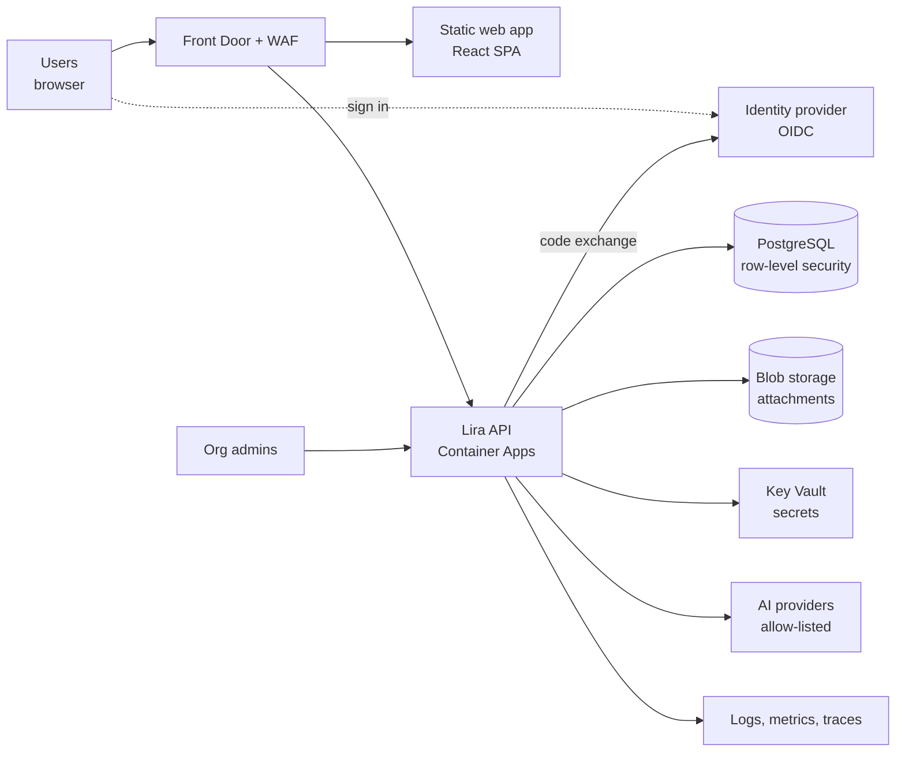

# High-Level Design (HLD): multi-user Lira with SSO

**Status: Proposed.** Choices that depend on a decision record are tagged `[ADR-000n]`. Nothing here is built yet. Baseline: [`current-state.md`](current-state.md).

## 1. Goals and non-goals

**Goals**
- Many people sign in with their organisation's SSO and work on shared spaces, boards, sprints, roadmaps and dashboards.
- Each user sees and changes only what their role allows; organisations are isolated from each other `[ADR-0004]`.
- Keep today's product behaviour (board, sprints, roadmaps, dashboards, Viva) and the local edition.
- Meet an enterprise bar for security, auditability, backup and operations.

**Non-goals (for this stage)**
- Offline editing (see `[ADR-0005]`), a mobile app, public marketplace apps, billing.

## 2. Context



External systems: the identity provider `[ADR-0001]`, AI model providers (admin-configured), calendar/e-mail for invites (later phase).

## 3. Components

| Component | Responsibility | Notes |
|---|---|---|
| **Web app (SPA)** | UI. Talks only to the API through a `DataStore` interface. | Same React code as today; `ApiStore` replaces local files `[ADR-0005]` |
| **API service** | Authentication session, authorisation, validation, business rules, audit, realtime events | Stateless container; Node/TypeScript `[ADR-0002]` |
| **Core package** | Types, zod schemas, sprint/roadmap/report logic, Viva's intent and sprint logic | Shared by web and API, no browser or file access `[ADR-0007]` |
| **Database** | System of record: orgs, users, memberships, spaces, tickets, comments, audit log | PostgreSQL + RLS `[ADR-0003]` |
| **Object storage** | Attachment bytes, referenced by id | Pre-signed, short-lived URLs; virus scan before release |
| **Identity provider** | Sign-in, MFA, group claims | OIDC code + PKCE; BFF session cookie `[ADR-0001]` |
| **Secret store** | Database credentials, AI keys, signing keys | Key Vault, accessed through managed identity |
| **Observability** | Structured logs, metrics, traces, alerts | Request id on every log line; no tokens or ticket bodies in logs |
| **Local edition** | Today's dev-server + JSON files, behind a mode flag | Kept for single users; cannot be enabled in hosted deployments |

## 4. Key flows

### 4.1 Sign-in (BFF pattern)

```mermaid
sequenceDiagram
  participant B as Browser
  participant A as Lira API
  participant I as Identity provider
  B->>A: GET /auth/login
  A-->>B: 302 to IdP (state, nonce, PKCE challenge)
  B->>I: authenticate (MFA at IdP)
  I-->>B: 302 to /auth/callback?code&state
  B->>A: GET /auth/callback
  A->>I: exchange code + PKCE verifier
  I-->>A: id_token (+ access token)
  A->>A: validate iss, aud, exp, nonce; find/create user by sub
  A-->>B: Set-Cookie session (HttpOnly, Secure, SameSite=Lax)
  B->>A: GET /api/v1/me (cookie)
  A-->>B: user, memberships, roles
```

### 4.2 Change a ticket

```mermaid
sequenceDiagram
  participant B as Browser
  participant A as API
  participant D as PostgreSQL
  B->>A: PATCH /api/v1/issues/{id} (version, fields) + CSRF token
  A->>A: session -> user; authorise(user, space, "issue:update")
  A->>A: validate body (zod, unknown fields rejected)
  A->>D: UPDATE ... WHERE id AND org_id AND version = n
  alt version matches
    D-->>A: 1 row
    A->>D: INSERT audit_log, status_log
    A-->>B: 200 new version
    A-->>B: (other clients) event issue.updated
  else stale
    D-->>A: 0 rows
    A-->>B: 409 conflict
  end
```

### 4.3 Viva AI request
User message → API → the **core** intent engine parses it with only the caller's permitted data → read answers return directly; write intents return a **preview**; the user confirms; the API applies the change as the user (same authorisation and audit path as a manual edit) and returns an undo token. Model providers receive only sanitised, size-limited text and never get write access `[existing rule, kept]`.

## 5. Data and tenancy (summary)
Organisation → Space → Ticket. Projects, Sprints, Roadmaps, Dashboards, Teams belong to an organisation. Every row carries `org_id`; Postgres RLS enforces it a second time. Details in [`LLD.md`](LLD.md).

## 6. Quality attributes (targets to be agreed)

| Attribute | Proposed target | How we verify |
|---|---|---|
| Security | OWASP ASVS L2 for the API and SPA; no critical/high findings open | Threat-model review, SAST/DAST, pen test before launch |
| Isolation | Zero cross-tenant reads/writes | Automated negative tests on every route |
| Availability | 99.9% monthly for the API (to be confirmed) | Health probes, alerts, status page |
| Performance | p95 board load < 1.5 s for 2,000 tickets in a space; p95 write < 300 ms | Load test in staging |
| Durability | Point-in-time restore; RPO ≤ 15 min, RTO ≤ 4 h (to be confirmed) | Quarterly restore drill (SOP 02) |
| Auditability | Every write and permission change recorded, retained per policy | Audit tests and sampling |
| Maintainability | Complexity/size limits in `CLAUDE.md`; ≥ today's 1585 tests, growing; zero lint warnings; no import cycles | Quality gates (DevOps step) |
| Accessibility | WCAG 2.1 AA for core flows | Axe checks, manual review |

## 7. Deployment view (target, built in the DevOps step)
Environments dev → staging → prod. Container image per release; database migrations run as a gated step; blue/green or revision-based rollout with a one-command rollback (SOP 01). Infrastructure as code. Private networking to the database and storage.

## 8. Migration approach
1. Extract the shared `core` package without behaviour change.
2. Introduce the `DataStore` interface; keep `LocalFilesStore` as the default.
3. Build the API and database; implement `ApiStore` feature by feature behind a flag.
4. Import existing data with the importer `[ADR-0008]`.
5. Turn on SSO and roles; remove the hosted deployment's ability to run in "no login" mode.

## 9. Risks

| Risk | Impact | Mitigation |
|---|---|---|
| Cross-tenant data leak | Severe | Two enforcement layers; negative test per route; code owners on data access |
| Stored XSS via rich text between users | High | Sanitise on write and render; strict CSP (exists today) |
| Big-bang rewrite stalls delivery | High | Strangler approach; one feature at a time behind `DataStore` |
| Embedded ticket arrays and base64 attachments slow the database | Medium | Normalise tables; move bytes to object storage |
| AI-generated code adds complexity and unreviewed security gaps | Medium | `CLAUDE.md` rules, review checklist, ratchet on complexity |
| Scope grows while decisions are open | High | Readiness gate in `00-decisions/README.md` |

## 10. Open questions
See "Open questions for the product owner" in [`../00-decisions/README.md`](../00-decisions/README.md).
