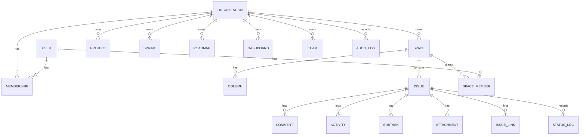
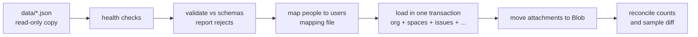

# Low-Level Design (LLD): multi-user Lira with SSO

**Status: Proposed.** Companion to [`HLD.md`](HLD.md). Table and field names are proposals; entity fields marked *(today)* come from `lira-app/src/types/`.

## 1. Module layout (target monorepo `[ADR-0007]`)

```
packages/
  core/        types, zod schemas, sprint/roadmap/report logic, Viva intent + sprint insights (pure)
  ui/          shared React components, themes (design tokens)
apps/
  web/         SPA (today's lira-app/src, using DataStore)
  api/         Fastify service
  local/       today's dev-server plugin + JSON files (local edition)
tools/
  importer/    JSON -> database importer [ADR-0008]
docs/ CLAUDE.md
```

API internal structure (`apps/api/src`): `routes/` (thin handlers) → `services/` (business rules, pure where possible) → `repositories/` (SQL only). Cross-cutting: `auth/` (session, OIDC), `authz/` (permission checks), `audit/`, `validation/`, `errors/`, `config/`. Handlers never contain SQL; repositories never contain authorisation.

## 2. Data model



### Key tables (proposed)

| Table | Important columns | Notes |
|---|---|---|
| `organizations` | `id`, `name`, `created_at` | Tenant |
| `users` | `id`, `idp_subject` (unique), `email`, `display_name`, `initials`, `status` (active/disabled), `last_login_at` | Key is the IdP `sub`, never the e-mail |
| `memberships` | `org_id`, `user_id`, `role` (owner/admin/member/viewer/guest) | Organisation role |
| `spaces` | `id`, `org_id`, `key`, `name`, `icon`, `color`, `description`, `archived`, `hidden`; unique `(org_id, key)` *(today: Space)* | |
| `space_members` | `space_id`, `user_id`, `role` (admin/member/viewer) | Space-level override |
| `columns` | `id`, `space_id`, `name`, `position`, `wip_limit`, `color` *(today: Column)* | |
| `issues` | `id`, `org_id`, `space_id`, `key`, `number`, `type`, `status`, `priority`, `parent_id`, `epic_id`, `title`, `description_html` (sanitised), `assignee_id`, `reporter_id`, `due_date`, `start_date`, `story_points`, `sprint_id`, `rank`, `blocked`, `blocked_at`, `labels text[]`, `version`, `created_at`, `updated_at`, `resolved_at` *(today: Issue)* | `assignee`/`reporter` become user ids; unique `(org_id, key)` |
| `comments` | `id`, `issue_id`, `author_id`, `body_html` (sanitised), `created_at`, `updated_at` | |
| `activity` | `id`, `issue_id`, `type`, `actor_id`, `old_value`, `new_value`, `created_at` | User-visible history |
| `status_log` | `issue_id`, `from_status`, `to_status`, `at` | Feeds flow metrics |
| `subtasks`, `issue_links`, `watchers` | normalised from the embedded arrays | `link_type`: relates_to, blocks, blocked_by, duplicates, cloned_by |
| `attachments` | `id`, `issue_id`/`comment_id`, `name`, `size`, `mime_type`, `blob_key`, `source`, `url`, `scan_status`, `uploaded_by` | Bytes in Blob; link-type attachments keep only `url` |
| `projects`, `sprints`, `teams`, `team_members`, `standups`, `roadmaps`, `roadmap_items`, `dashboards` | from today's JSON files and `structuredStore.ts` rows | Dashboard widget config as JSONB |
| `user_preferences` | `user_id`, `key`, `value` | Theme, light palette, sidebar. Replaces per-browser `lira_*` keys that are personal |
| `ai_settings` | `org_id`, `provider`, `base_url` (admin allow-listed), `model`, `secret_ref` | Key stored in Key Vault, not here |
| `audit_log` | `id`, `org_id`, `actor_id`, `action`, `object_type`, `object_id`, `before`, `after`, `ip`, `request_id`, `at` | Append-only; no UPDATE/DELETE grant |

Every tenant table has `org_id NOT NULL` and a row-level-security policy `org_id = current_setting('app.org_id')::uuid`. The API sets `app.org_id` per request inside the transaction.

Optimistic concurrency: `issues.version` (and the same on other mutable rows) increments on every write; updates include `WHERE version = :expected`.

## 3. API design

Base `/api/v1`, JSON, session cookie, CSRF token header on state-changing methods. OpenAPI is generated from the zod schemas.

| Area | Endpoints (proposed) |
|---|---|
| Auth | `GET /auth/login`, `GET /auth/callback`, `POST /auth/logout`, `GET /me` |
| Orgs and users | `GET/PATCH /orgs/{id}`, `GET /orgs/{id}/members`, `POST /orgs/{id}/members`, `PATCH/DELETE /orgs/{id}/members/{userId}` |
| Spaces | `GET/POST /spaces`, `GET/PATCH/DELETE /spaces/{key}`, `GET/PUT /spaces/{key}/columns`, `GET/PUT /spaces/{key}/members` |
| Issues | `GET /spaces/{key}/issues?filter&cursor`, `POST /spaces/{key}/issues`, `GET/PATCH/DELETE /issues/{key}`, `POST /issues/{key}/move`, `POST /issues/bulk` |
| Issue parts | `GET/POST /issues/{key}/comments`, `PATCH/DELETE /comments/{id}`, `POST /issues/{key}/attachments` (returns upload URL), `GET /attachments/{id}` (short-lived download URL), `POST/DELETE /issues/{key}/links` |
| Planning | `/projects`, `/sprints`, `/roadmaps`, `/teams`, `/standups`, `/dashboards` (CRUD each) |
| Search | `GET /search?q&filters` (permission-filtered) |
| AI | `POST /ai/message` → reply or preview; `POST /ai/confirm`; `POST /ai/undo` |
| Realtime | `GET /events` (Server-Sent Events, per organisation, permission-filtered) |
| Admin | `GET /audit?filters`, `GET/PUT /ai/settings` (admin), `GET /health`, `GET /ready` |

Conventions: cursor pagination (`limit` ≤ 100); errors as `{ "error": { "code", "message", "requestId" } }` with no stack traces; `409` for version conflicts; `422` for validation failures; `403` vs `404`: use `404` when the caller must not learn that an object exists.

## 4. Authorisation

```
authorize(user, action, resource) -> allow | deny
  1. user must be active and a member of resource.org_id
  2. effective role = max(org role, space role if resource is in a space)
  3. action must be in the role's permission set (access-control-matrix.md)
  4. deny by default
```

- Implemented once in `authz/` as a pure function with a table-driven test per cell of the access-control matrix.
- Every handler calls it **before** touching data, and list queries add the same constraint in SQL (a user's accessible `space_id` set).
- RLS is a second layer: a coding mistake yields an empty result, not a leak.
- Guests (external) are limited to spaces they are explicitly added to and cannot list members.

## 5. Validation and output safety

- Request bodies, params and queries validated with zod `strict()` schemas; unknown fields rejected; ids are UUIDs; strings have max lengths; dates ISO-8601.
- Rich text (`description_html`, `body_html`): sanitise on write with an allow-list (tags: headings, p, br, strong, em, u, s, ul, ol, li, blockquote, code, pre, a, img, span with colour/highlight classes; no scripts, event attributes, `javascript:` or `data:` URLs except approved image types). Sanitise again when rendering.
- Links accepted only with `http`/`https` (`safeUrl` exists today).
- Uploads: allow-listed MIME types, size limit, content sniffing, antivirus scan; served from a separate domain/with `Content-Disposition: attachment` for non-images.
- Response headers: CSP (carry over today's policy), `X-Content-Type-Options`, frame-ancestors none, HSTS, `Referrer-Policy`.

## 6. Realtime and sync (`[ADR-0005]`)

- Client `DataStore` caches reads; writes are optimistic and rolled back on error.
- The API emits `issue.created|updated|deleted`, `comment.created`, `sprint.updated` events on SSE, already filtered by the subscriber's permissions.
- On `409`, the UI shows the server's version and lets the user re-apply their change.
- Cache cleared on logout and when the signed-in user changes.

## 7. Viva (AI) on the server

- `core` intent engine receives `(message, context)` where `context` is built from rows the caller may read, size-limited and with ticket text flattened/marked as data (existing behaviour in `src/services/ai/context.ts`).
- Write intents return a `preview`; `confirm` applies it through the same service functions and authorisation as manual edits; `undo` restores from a stored snapshot (today: last 20, in memory; target: persisted per user with expiry).
- Model providers: base URLs come only from `ai_settings` set by an org admin and checked against an allow-list; the server refuses private/loopback addresses (SSRF). Keys in Key Vault.
- Per-user rate limit and per-org token budget.

## 8. Audit and logging

- `audit_log` rows for: sign-in/out, permission or role changes, member add/remove, space create/delete/archive, bulk actions, imports, exports, AI confirm/undo, settings changes, plus the create/update/delete of tickets and comments.
- Application logs: JSON, with `requestId`, `userId`, `orgId`, route, status, duration. Never log tokens, cookies, ticket text or attachment bytes.

## 9. Configuration

| Variable | Purpose |
|---|---|
| `LIRA_MODE` | `local` (default) or `hosted`. In `hosted`, "no login" is impossible |
| `DATABASE_URL` | From Key Vault reference, not a file |
| `OIDC_ISSUER`, `OIDC_CLIENT_ID`, `OIDC_REDIRECT_URI` | Identity provider; the client secret from Key Vault |
| `SESSION_TTL_MINUTES`, `SESSION_IDLE_MINUTES` | Session limits |
| `ALLOWED_ORIGINS` | CORS and CSRF origin check |
| `BLOB_ACCOUNT`, `BLOB_CONTAINER` | Attachments |
| `AI_ALLOWED_HOSTS` | Allow-list for model providers |

A `.env.example` lists names only. Real values never enter the repository.

## 10. Migration (`[ADR-0008]`)



Steps are idempotent; `--dry-run` prints counts per entity. Dates are parsed once and stored as timestamps. Ticket keys keep their value; the per-space counter is set to the highest existing number.

## 11. Testing (see [`../04-quality/test-strategy.md`](../04-quality/test-strategy.md))
Unit (core logic, authz matrix), repository tests against a real PostgreSQL container, API contract tests from OpenAPI, tenant-isolation tests generated from the route table, importer tests on fixtures, UI component tests, and a small end-to-end suite for sign-in, create ticket, move card, conflict.

## 12. Open items
- Exact role names and permission cells (review `../02-security/access-control-matrix.md`).
- Whether guests exist at launch.
- Retention periods for audit logs and attachments.
- Search implementation (PostgreSQL full-text vs external).
