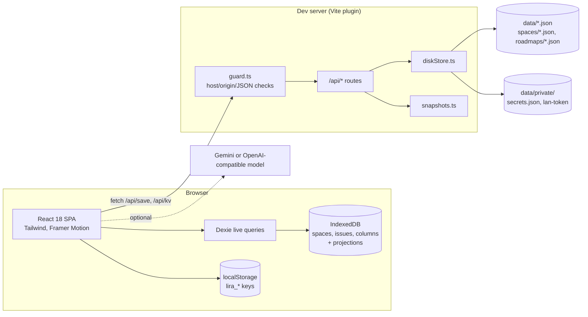

# Current state (single-user, local edition)

Verified on 9 November 2026 at commit `4eb938e`, branch `v3.4.1`.

## Shape

## Facts

| Area | Today |
|---|---|
| Language / build | TypeScript 7, React 18.3.1, Vite 8, Tailwind 3.4, React Router 7 |
| Size | ~360 source files; about 33.4k lines of non-test code; 1585 automated tests in 138 files plus a 15-check data health run |
| Users | None. UI assumes one user ("VY"). No login. |
| Source of truth | JSON files under `data/`. Browser storage is a cache. |
| Tickets | Dexie tables `spaces`, `issues`, `columns` (3 schema versions); saved to `data/spaces/<KEY>.json` by `localDiskSync.ts` |
| Settings-style data | `localStorage` keys `lira_*` → `data/{projects,sprints,teams,standups,dashboards,board-config,settings}.json` through `kvMirror.ts`; roadmaps one file each; secrets in `data/private/secrets.json` |
| Server | Only the Vite dev-server plugin (`vite.config.ts`, `server/`). `npm run preview` or a built copy cannot save to disk. |
| API | `GET /api/health`, `/api/data`, `/api/spaces`, `/api/lan` (this computer only), `/api/snapshots`, `/api/snapshot`, `/api/kv`; `POST /api/save`, `/api/kv`, `/api/snapshot` |
| API protection | `guard.ts`: Host must be this computer (or a private network address in LAN mode), Origin must match, `Sec-Fetch-Site` must be same-origin, writes must be `application/json`, 50 MB body cap, reserved keys refused, safe file names, CSP and other security headers |
| Network access | `npm run dev:lan` allows private-network addresses; other devices need a link with a secret token and then hold an HttpOnly cookie |
| AI (Viva) | `src/services/ai/`: intent parser, read/write/sprint/dashboard handlers, preview → confirm → undo. Model providers: built-in engine (default), Gemini, OpenAI-compatible. Models never write tickets. |
| Code seams | Browser settings go through `utils/appStorage.ts` (one place to clear or prefix per user later); the clock through `utils/clock.ts`; fixed colours through `theme/palette.ts`; screens that reset a draft use `hooks/useResetWhen.ts`. Rules enforced by `src/hygiene.test.ts` |
| Routes | `/for-you`, `/filters`, `/projects[/id]`, `/sprints[/YYYY-MM]`, `/tickets`, `/roadmaps[/id]`, `/dashboards[/id]`, `/space/<KEY>/<tab>`, `?issue=KEY-n` (`src/routes.ts`) |

## Domain model (from `src/types/`)

- **Space** `{id, name, key, icon, color, description}` with **Columns** `{id, spaceId, name, order, wipLimit}`.
- **Issue** `{id, spaceId, key, type: epic|task|bug|subtask, status, priority, parentId, epicId, assignee, reporter, labels, dueDate, storyPoints, sprint, rank, blocked, blockedByIds}` with embedded arrays `subtasks`, `comments` (HTML), `activity`, `attachments` (base64 or link), `linkedIssues`, `statusLog`, `watchers`.
- **Project** `{id, name, key, lead, spaceId, repoUrl, environments}`. **Sprint**, **Team**, **Standup**, **Roadmap**, **Dashboard** are held as JSON structures (see `structuredStore.ts` for the row shapes).

## What this means for multi-user

1. No identity, roles or ownership exist anywhere in the data. "Reporter/assignee" are display strings, not user ids.
2. The server is a dev plugin, not a deployable service.
3. Shared state lives in `localStorage`; conflict rule "disk wins unless the browser is dirty" does not work between people.
4. Rich text is stored as HTML in tickets and comments: harmless for one user, a stored-XSS channel between users.
5. Attachments are base64 inside ticket JSON (50 MB request cap).
6. Viva reads every space; with permissions it must read only what the caller may see.
7. The AI provider base URL and keys are configured in the browser; a server-side AI call with a user-supplied URL would be a request-forgery risk.

Each point maps to a decision record in [`../00-decisions/`](../00-decisions/README.md).
